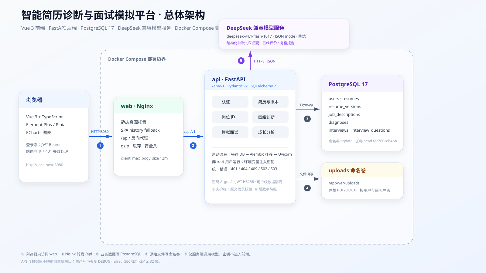
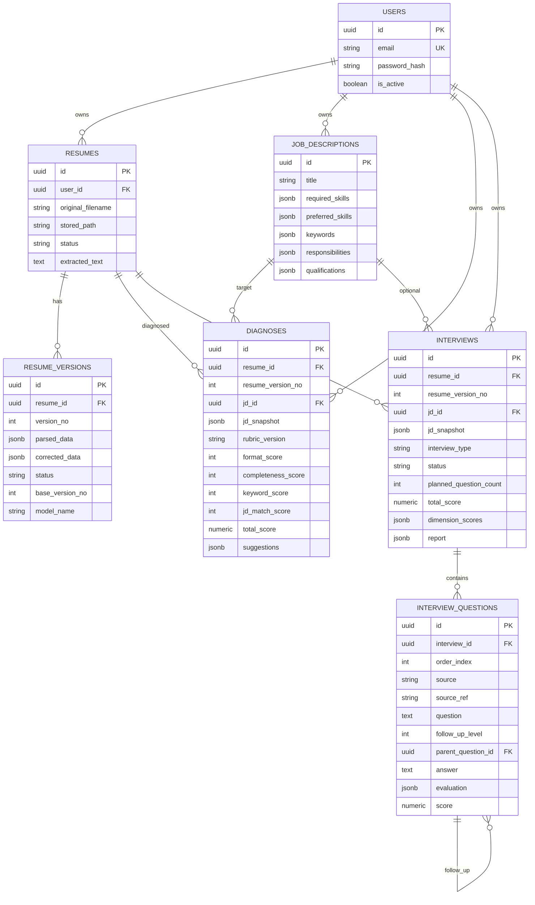
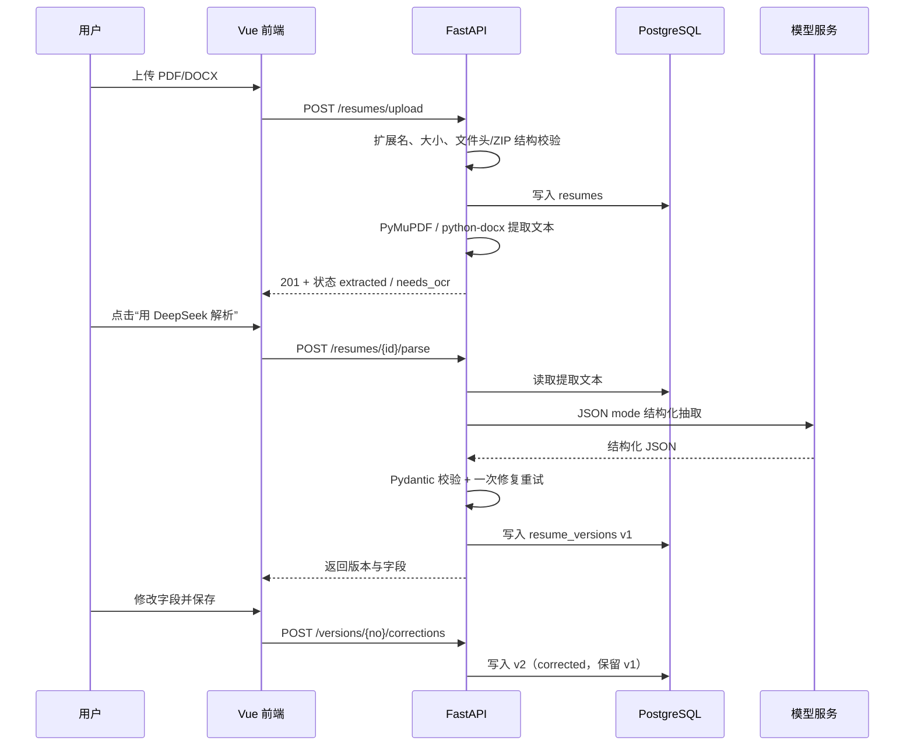
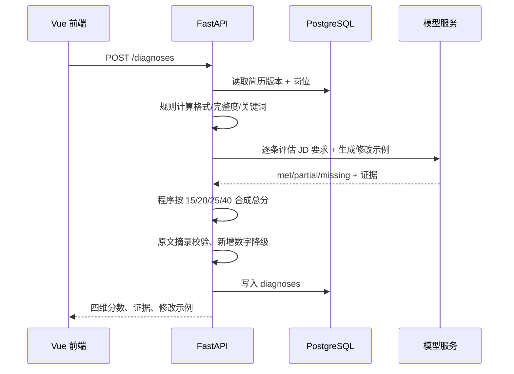
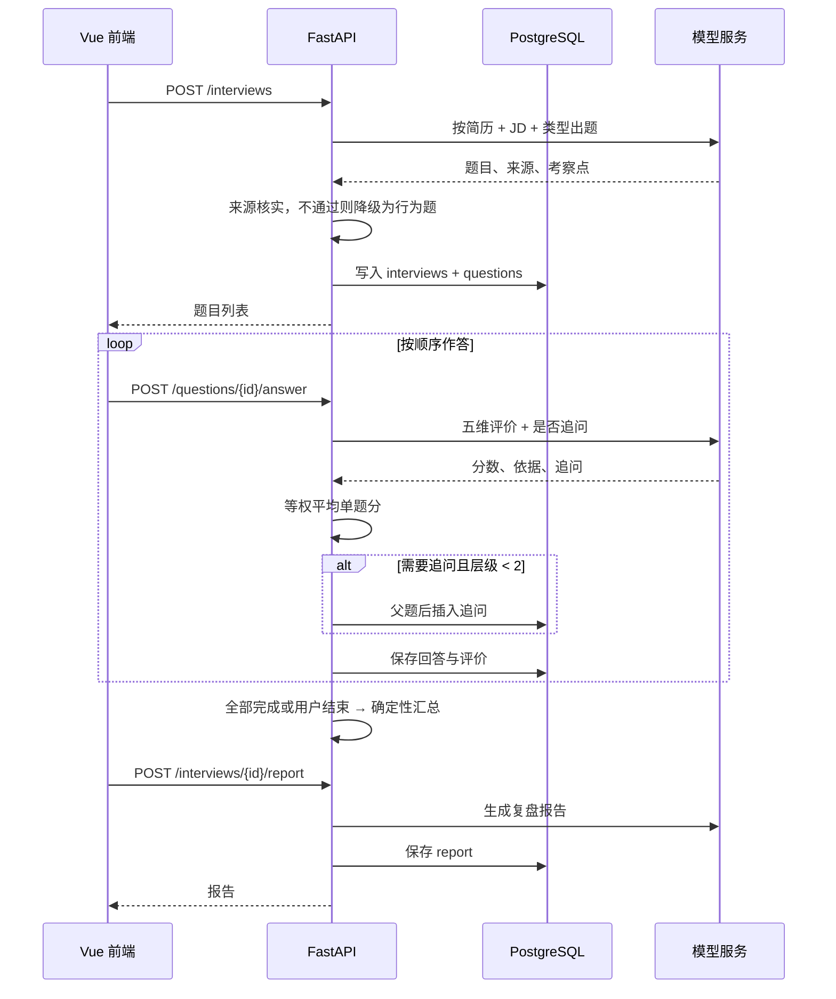

# 系统架构说明

> 对应代码版本：`main`（阶段 7 部署完成）
> 用途：论文系统设计章节、答辩架构讲解、后续维护交接

## 1. 总体架构



系统采用前后端分离 + 单体后端 + 独立数据库的架构：

| 层次 | 技术 | 职责 |
|---|---|---|
| 前端 | Vue 3 + TypeScript + Vite + Element Plus + Pinia + ECharts | 页面交互、表单校验、路由守卫、图表展示 |
| Web 网关 | Nginx 1.27 | 静态资源、SPA fallback、`/api/` 反向代理、gzip 与安全头 |
| 后端 | Python 3.13 + FastAPI + Pydantic v2 + SQLAlchemy 2 | REST API、认证、业务编排、规则评分、模型调用 |
| 数据库 | PostgreSQL 17 | 用户、简历、版本、岗位、诊断、面试与题目 |
| 文件存储 | 本地命名卷 `uploads` | 原始 PDF/DOCX 文件，按用户与简历隔离 |
| 模型服务 | DeepSeek 兼容网关（`deepseek-v4.1-flash-1017`） | 结构化抽取、JD 匹配、面试评价、复盘报告 |
| 部署 | Docker Compose | `db` / `api` / `web` 三服务，健康检查与自动迁移 |

设计边界：

- 浏览器只访问 `web`，前后端同源，不依赖 CORS。
- `api` 与 `db` 不映射宿主机端口；模型密钥只存在服务端环境变量。
- 不实现视频面试、表情识别、社区、UGC 题库和企业招聘端。

## 2. 后端模块

```text
backend/app/
├── api/
│   ├── deps.py              # 当前用户、数据库会话、模型 Provider 依赖
│   ├── router.py            # /api/v1 路由聚合
│   └── routes/
│       ├── auth.py          # 注册、登录、当前用户
│       ├── resumes.py       # 上传、列表、详情、删除
│       ├── resume_versions.py # 解析、版本、人工校正
│       ├── jds.py           # 岗位 CRUD
│       ├── diagnoses.py     # 四维诊断
│       ├── interviews.py    # 面试创建、作答、结束、报告
│       └── analytics.py     # 成长分析
├── core/
│   ├── config.py            # Pydantic Settings，生产安全校验
│   ├── logging.py
│   └── security.py          # Argon2 + JWT
├── db/                      # SQLAlchemy Base、异步会话
├── models/                  # 7 张业务表
├── providers/
│   ├── base.py              # JsonCompletionProvider 协议
│   └── deepseek.py          # OpenAI 兼容 JSON 调用、重试
├── schemas/                 # Pydantic 请求/响应模型
└── services/
    ├── auth.py
    ├── resume_files.py      # 文件校验
    ├── resume_extraction.py # PyMuPDF / python-docx
    ├── resume_parser.py     # 结构化抽取 Prompt
    ├── resume_versions.py   # 版本与校正
    ├── diagnosis_rules.py   # 四维规则评分
    ├── diagnosis_parser.py  # JD 匹配与修改示例
    ├── diagnoses.py
    ├── interview_plan.py    # 出题与来源核实
    ├── interview_eval.py    # 五维评价与追问
    ├── interview_report.py  # 复盘报告
    ├── interviews.py        # 面试状态机与汇总
    └── analytics.py         # 只读聚合
```

分层约定：

- 路由层只做参数校验、异常映射与响应序列化。
- 业务编排在 `services/`，模型调用通过 `JsonCompletionProvider` 协议注入，测试时替换为假 Provider。
- 所有查询显式带 `user_id` 条件，保证用户级数据隔离。
- 模型调用前释放只读事务，避免长时间 `idle in transaction`。

## 3. 数据模型



关键设计：

- 简历采用“原文件 + 提取文本 + 结构化版本”三层结构，版本只增不改。
- 诊断保存 `jd_snapshot`，岗位后续修改不影响历史诊断。
- 面试保存 `jd_snapshot` 与题目来源，JD 删除后仍可复盘。
- 评分口径字段：诊断 `rubric_v1`，面试 `interview_rubric_v1`，并保存 `prompt_version` 与模型名。

## 4. 关键流程

### 4.1 简历结构化



事实约束：

- 每条教育/工作/项目/证书/奖项都保留 `source_text`。
- 解析 Prompt 明确禁止编造公司、项目、技能、证书与数字。
- 人工校正生成新版本，原始模型输出不被覆盖。

### 4.2 四维诊断



为什么要规则 + 模型：

- 规则保证分数可复现、可解释、同口径可比较。
- 模型只提供语义证据与改写建议，不直接决定总分，降低“拍脑袋打分”的风险。

### 4.3 模拟面试



状态机：

```text
ready ──首题作答──▶ in_progress ──全部答完/提前结束──▶ completed
```

- 必须按顺序作答；跳题、重复提交、结束后再答返回 409。
- 追问最多两级，插入父题之后，后续题号自动后移。
- 结束只做确定性汇总；报告单独生成，可重试，已生成时走缓存。

### 4.4 成长分析

- 只读聚合，不新建业务表。
- 诊断分组：`resume_id + jd_id + rubric_version`。
- 面试分组：`resume_id + jd_id + interview_type + rubric_version`，只统计已完成。
- 输出平均/最高/首末变化、缺失关键词、未满足要求、五维均分与最低维度。

## 5. 安全与可靠性

- 密码：Argon2 哈希，不保存明文。
- 认证：JWT HS256，Bearer Token，401 统一处理。
- 数据隔离：所有业务查询带 `user_id`；跨用户访问返回 404。
- 文件：文件名清洗、UUID 目录、大小限制、PDF 文件头 / DOCX ZIP 结构校验。
- 密钥：只从环境变量读取；`.env`、`.env.docker` 均被 Git 忽略。
- 生产校验：`ENVIRONMENT=production` 时强制 `DEBUG=false`、`SECRET_KEY` ≥ 32 位。
- 模型调用：429/5xx 指数退避重试；4xx 不重试；返回空内容或非法 JSON 明确报错。
- 容器：非 root 用户、健康检查、命名卷、日志轮转、启动时自动迁移。

## 6. 设计取舍

| 取舍 | 选择 | 原因 |
|---|---|---|
| 数据库 | 只用 PostgreSQL | JSONB、索引、事务与迁移能力更适合结构化简历；避免 SQLite 与生产不一致 |
| 分数来源 | 规则算分 + 模型给证据 | 可复现、可解释，便于历史对比与答辩说明 |
| 简历版本 | 只增不改 | 支持诊断/面试回溯，避免历史记录被覆盖 |
| 面试评价 | 五维等权 | 简单透明，便于解释；后续可按题型加权 |
| 报告生成 | 与结束分离 | 结束必须确定性完成，报告失败可重试 |
| 成长口径 | 严格分组 | 不同岗位、类型、`rubric_version` 不混算，避免误导 |
| 部署 | 单体后端 + Compose | 毕业设计规模下运维简单，便于演示与复现 |

## 7. 已知限制

- 图片简历未接 OCR；扫描 PDF 返回 `needs_ocr`。
- 诊断与面试为同步模型调用；模型超时已调到 120 秒，Nginx 读超时 180 秒。
- 成长分析在 Python 内聚合，单次最多 300 条记录。
- 未做并发压测、无障碍测试与多浏览器兼容性测试。
- 真实模型质量已验证 3b 解析/校正与 4/5 链路；诊断分数区分度与面试追问质量仍需更多样本调优。
